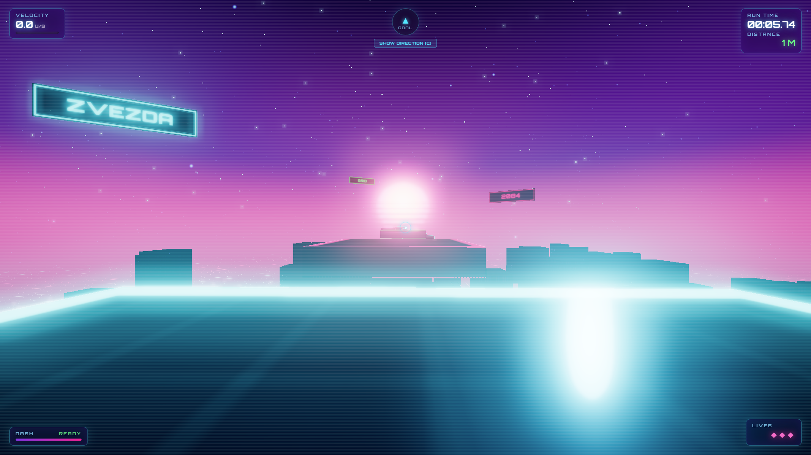
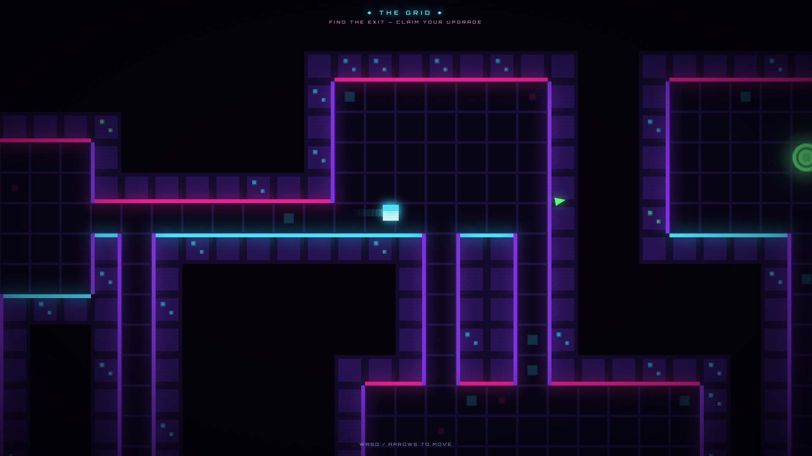

# Zvezda

# [▶️ PLAY ZVEZDA NOW](https://trnovan.github.io/Zvezda/)

**Endless First-Person Cyberpunk Parkour**

ZVEZDA is a fast-paced, single-file browser game built with Three.js. Run across an infinite synthwave skyline, dive into pixel-art dungeons to claim upgrades, and gamble your run when you fall. 

No build tools, no server, no dependencies to install. Just open the link and play.

  
  

## ✨ Features

*   **Endless Procedural City:** A constantly generating path of neon platforms, moving obstacles, and laser hazards.
*   **Fast-Paced Movement:** Responsive first-person controls with sprinting, double jumps, and air-dashing.
*   **The Grid (2D Dungeon):** Every 60 seconds, the Grid opens. Dive into a procedurally generated retro pixel maze to find the exit and claim an upgrade (Speed, Jump, or Extra Life).
*   **Revive Gamble:** Lost all your lives? Risk it all in one of five neon mini-games (Blackjack, Roulette, Slots, Higher/Lower, Plinko) for a chance to revive. Win and you come back with 1 heart (Slots gives 2!).
*   **Synthwave Aesthetics:** Custom GLSL shaders for the glowing floor, Unreal Bloom post-processing, dynamic fog, and a retro-futuristic HUD.
*   **Procedural Audio:** All sound effects (jumping, dashing, losing) are synthesized in real-time using the Web Audio API. No external audio files.

## 🎮 Controls

| Key | Action |
| :--- | :--- |
| **W, A, S, D** | Move |
| **Mouse** | Look |
| **Space** | Jump / Double Jump |
| **Shift** | Sprint |
| **Q** | Dash (Brief invincibility) |
| **E** | Enter The Grid (When prompted) |
| **C** | Show Compass (Point towards the goal) |
| **Esc** | Pause |

## 🚀 How to Play

You can play the game immediately in your browser by visiting:
👉 **[https://trnovan.github.io/Zvezda/](https://trnovan.github.io/Zvezda/)**

To run it locally:
1. Clone or download this repository.
2. Double-click `index.html` to open it in any modern desktop browser (Chrome, Firefox, Edge).
3. Click **"CLICK TO JACK IN"** to lock your mouse and start running.

## 🛠️ Tech Stack

*   **HTML5 / CSS3** (Glassmorphism UI, Flexbox/Grid)
*   **Vanilla JavaScript** (ES6 Modules)
*   **[Three.js](https://threejs.org/)** (3D rendering via CDN)
*   **Web Audio API** (Procedural sound synthesis)
*   **Canvas 2D API** (For the retro pixel dungeon)

## 📜 License

This project is open-source and available under the [MIT License](LICENSE).
